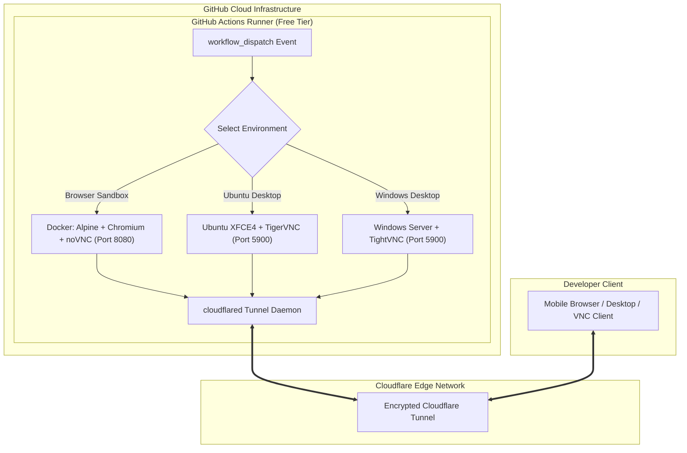

# 🧪 OS Sandbox Lab — On-Demand Free Cloud Test Environments

[](#)
[](#)
[](#)
[](#)

> **Free, ephemeral, multi-operating system environments running directly on GitHub Actions cloud infrastructure for testing web, desktop, and mobile applications.**

---

## 📖 Table of Contents
1. [Why OS Sandbox Lab?](#-why-os-sandbox-lab)
2. [How It Works](#-how-it-works)
3. [Available Test Environments](#-available-test-environments)
   - [1. Web & Mobile Browser Sandbox (Alpine Linux + noVNC)](#1-web--mobile-browser-sandbox-alpine-linux--novnc)
   - [2. Linux Desktop Lab (Ubuntu XFCE4 + TigerVNC)](#2-linux-desktop-lab-ubuntu-xfce4--tigervnc)
   - [3. Windows Desktop Lab (Windows Server + TightVNC)](#3-windows-desktop-lab-windows-server--tightvnc)
4. [Runner Lifetime & Constraints](#-runner-lifetime--constraints)
5. [⚠️ Security & Execution Model (Why You Must Fork)](#-security--execution-model-why-you-must-fork)
6. [🚀 Quickstart: How to Fork and Run in Your Account](#-quickstart-how-to-fork-and-run-in-your-account)
7. [Secrets & Configuration](#-secrets--configuration)
8. [Local Development (Docker Compose)](#-local-development-docker-compose)
9. [Architecture Diagram](#-architecture-diagram)

---

## 💡 Why OS Sandbox Lab?

During application development, testing across multiple operating systems (Linux, Windows, mobile viewports) and browsers is essential. However:
- **Physical devices and secondary testing machines are expensive.**
- **Commercial device farms (BrowserStack, SauceLabs) carry recurring subscription fees.**
- **Local virtual machines consume large amounts of CPU, RAM, and battery.**

**OS Sandbox Lab** solves this by utilizing **GitHub Actions free hosted runners**. GitHub provides Ubuntu and Windows enterprise cloud runners for free (up to 2,000 monthly runner minutes per personal account). This repository provisions full GUI desktops and browser sandboxes inside GitHub's cloud and establishes a secure tunnel so you can interact with them from anywhere in real-time.

---

## ⚙️ How It Works

```
┌─────────────────────────────────────────────────────────────────────────────┐
│                       GitHub Actions Hosted Runner                          │
│                                                                             │
│   ┌─────────────────────┐   Display    ┌────────────────────────────────┐   │
│   │ OS / Container GUI  │ ───────────> │ VNC Server / noVNC WebSocket   │   │
│   │ (Alpine/Ubuntu/Win) │              │ (Ports: 8080 or 5900)          │   │
│   └─────────────────────┘              └──────────────┬─────────────────┘   │
│                                                       │                     │
│                                        Local Traffic  ▼                     │
│                                        ┌────────────────────────────────┐   │
│                                        │ cloudflared (Tunnel Daemon)    │   │
│                                        └──────────────┬─────────────────┘   │
└───────────────────────────────────────────────────────┼─────────────────────┘
                                                        │ Encrypted Wire
                                                        ▼
                                         ┌─────────────────────────────┐
                                         │  Cloudflare Global Network  │
                                         └──────────────┬──────────────┘
                                                        │
                                                        ▼
                                         ┌─────────────────────────────┐
                                         │ Your Local Device / Browser │
                                         │ (Phone, Tablet, Laptop)     │
                                         └─────────────────────────────┘
```

1. **On-Demand Dispatch**: You trigger a workflow manually from GitHub Actions (`workflow_dispatch`).
2. **Environment Boot**: The GitHub runner installs the requested OS desktop stack (XFCE, TightVNC, or Docker + noVNC).
3. **Tunneling**: The runner starts `cloudflared`.
   - **Quick Tunnel Mode (Zero Setup)**: Generates a temporary public `https://*.trycloudflare.com` URL in the GitHub Step Summary.
   - **Permanent Tunnel Mode (Zero Trust)**: Connects to your private Cloudflare Tunnel domain.
4. **Interactive Remote Session**: You open the generated link in any browser or connect your VNC client.
5. **Keep-Alive Loop**: The runner stays alive for your specified duration (15 to 360 minutes).
6. **Clean Teardown**: Once finished or timed out, the runner cleanly disposes of all containers and state.

---

## 🖥️ Available Test Environments

### 1. Web & Mobile Browser Sandbox (Alpine Linux + noVNC)
* **Workflow File**: [`.github/workflows/browser-sandbox.yml`](file:///.github/workflows/browser-sandbox.yml)
* **Runner**: `ubuntu-latest`
* **Access Method**: **100% Web Browser (HTML5 Web GUI)** — zero client installation required! Connect directly from your iPhone, Android, iPad, or desktop browser.
* **Features**:
  * Ultra-lightweight Alpine Linux container running Chromium browser via Openbox & Xvfb.
  * Built-in developer testing scratchpad (`notes.html`) for 1-click clipboard syncing and quick test credentials.
  * Supports DevTools responsive device emulation to test mobile screen sizes (iOS Safari, Android Chrome).
  * Choice between custom repo Dockerfile or `linuxserver/chromium`.
  * Automatic Quick Tunnel (`trycloudflare.com`) URL printed to the workflow summary.

### 2. Linux Desktop Lab (Ubuntu XFCE4 + TigerVNC)
* **Workflow File**: [`.github/workflows/remote-desktop-ubuntu.yml`](file:///.github/workflows/remote-desktop-ubuntu.yml)
* **Runner**: `ubuntu-latest`
* **Access Method**: VNC Client (TigerVNC, RealVNC, Remmina) or Cloudflare Access tunnel.
* **Features**:
  * Full XFCE4 desktop GUI on Ubuntu Linux.
  * Full terminal, package manager (`apt`), and development toolchain.
  * Test Linux GUI desktop applications, Python GUI tools, Electron apps, and CLI scripts.
  * Secured with VNC password authentication.

### 3. Windows Desktop Lab (Windows Server + TightVNC)
* **Workflow File**: [`.github/workflows/remote-desktop.yml`](file:///.github/workflows/remote-desktop.yml)
* **Runner**: `windows-latest`
* **Access Method**: VNC Client (TightVNC, RealVNC) over Cloudflare Tunnel.
* **Features**:
  * Full Windows Server GUI desktop environment.
  * Pre-configured TightVNC server with DES-ECB registry authentication.
  * Test Windows desktop applications, Edge browser, `.exe` / `.msi` installers, and PowerShell scripts.

---

## ⏱️ Runner Lifetime & Constraints

GitHub Actions is designed for CI/CD automation, so hosted runners have specific operational parameters:

| Parameter | Specification | Notes |
| :--- | :--- | :--- |
| **Maximum Session Duration** | **6 Hours (360 Minutes)** | Hard limit enforced by GitHub per single job. |
| **Supported Selectable Durations** | 15, 30, 60, 120, 180, 360 mins | Configurable on workflow launch. |
| **Free Tier Minutes** | **2,000 Minutes / Month** | Allocated per GitHub user account every month. |
| **State Persistence** | **Ephemeral (Stateless)** | Every runner starts completely fresh; all data is destroyed on teardown. |
| **Internet Bandwidth** | **Up to 10 Gbps** | High-speed cloud connection provided by Microsoft Azure / GitHub. |

> [!NOTE]
> When your session reaches its duration limit or the 6-hour ceiling, the runner terminates automatically. If you need more time, simply start a new workflow run with a single click.

---

## 🔒 Security & Execution Model (Why You Must Fork)

### ⚠️ Strict Upstream Execution Protection
To protect the original repository owner's GitHub Actions quota and ensure fair usage:

1. **No External Dispatches on Upstream**: GitHub's security architecture prevents public visitors from triggering `workflow_dispatch` on repositories where they do not have collaborator write permissions.
2. **Automated Triggers are Disabled**: All automatic triggers (`push: branches: [main]`, `pull_request`) have been intentionally removed from all workflows in this repository.
3. **Zero Minute Deductions from Owner**: Workflows can **NEVER** run on the original repository on behalf of external users.

### 👤 Why You Must Run in Your Own Fork
By **Forking** this repository into your personal GitHub account:
- You become the administrator of your own forked copy.
- The workflows run on **your account's 2,000 free monthly minutes**.
- You have complete control over your own repository secrets and credentials.
- Your testing data, sessions, and tunnels remain 100% private to you.

---

## 🚀 Quickstart: How to Fork and Run in Your Account

Follow these 4 simple steps to run your own cloud testing devices for free:

### Step 1: Fork the Repository
Click the **Fork** button at the top-right corner of this GitHub repository page:
```
[Fork] ➔ Select your personal GitHub account ➔ Create fork
```

### Step 2: Enable GitHub Actions on Your Fork
By default, GitHub disables Actions on newly forked repositories for safety.
1. Navigate to your forked repository on GitHub.
2. Click on the **Actions** tab at the top.
3. Click the green button that says:
   > **"I understand my workflows, go ahead and enable them"**

### Step 3: Configure Secrets (If using VNC or Permanent Cloudflare Tunnel)
If you want to use the **Browser Sandbox** with Quick Tunnel (`trycloudflare.com`), **no secrets are required**!

If you want to use **Ubuntu Remote Desktop**, **Windows Remote Desktop**, or a permanent Cloudflare domain:
1. Go to your fork's **Settings** ➔ **Secrets and variables** ➔ **Actions**.
2. Click **New repository secret** and add:
   - `CLOUDFLARE_TUNNEL_TOKEN`: Your Cloudflare Zero Trust tunnel token.
   - `VNC_PASSWORD` *(Optional)*: Password to protect your VNC session (defaults to `VncPass123!`).

### Step 4: Launch Your Cloud Device
1. In your fork, click the **Actions** tab.
2. In the left sidebar, choose the environment you want to run:
   - **`Browser Sandbox (Cloudflare)`**
   - **`Remote Desktop - Ubuntu (TigerVNC + Cloudflare Tunnel)`**
   - **`Remote Desktop - Windows (VNC + Cloudflare Tunnel)`**
3. Click the **Run workflow** dropdown on the right:
   - Choose your session duration (e.g., 60 minutes).
   - Click the green **Run workflow** button.
4. Once the job starts (approx. 20–30 seconds), open the running workflow and check the **Summary** tab to copy your live access link!

---

## 🔑 Secrets & Configuration

| Secret Name | Required? | Applicable Workflows | Description |
| :--- | :--- | :--- | :--- |
| `CLOUDFLARE_TUNNEL_TOKEN` | Optional for Browser; Required for Ubuntu/Windows | All | Your Cloudflare Zero Trust connector token. |
| `VNC_PASSWORD` | Optional | Ubuntu & Windows | VNC desktop access password (defaults to `VncPass123!`). |

### How to get a free Cloudflare Tunnel Token:
1. Sign up for a free account at [Cloudflare Zero Trust](https://one.dash.cloudflare.com/).
2. Go to **Networks** ➔ **Tunnels** ➔ **Create a tunnel**.
3. Choose **Cloudflared**, name your tunnel (e.g., `os-sandbox`), and copy the tunnel token.
4. In **Public Hostnames**, route your desired subdomain to:
   - For Browser Sandbox: `HTTP` ➔ `localhost:8080`
   - For VNC (Ubuntu / Windows): `TCP` ➔ `localhost:5900`

---

## 💻 Local Development (Docker Compose)

You can also run the lightweight Alpine + Chromium sandbox directly on your local computer:

### 1. Build and Run
```bash
docker compose up -d --build
```

### 2. Access Web GUI
Open your browser and navigate to:
```
http://localhost:9999
```
or directly to:
```
http://localhost:9999/vnc.html
```

### 3. Sync Clipboard from Host (macOS/Linux)
```bash
# Sync whatever you just copied:
pbpaste | ./clip.sh

# Or send specific text:
./clip.sh "Hello from host"
```

### 4. Stop Container
```bash
docker compose down
```

---

## 🏗️ Architecture Diagram



---

## 📜 License

This project is licensed under the MIT License. See [LICENSE](LICENSE) for details.
